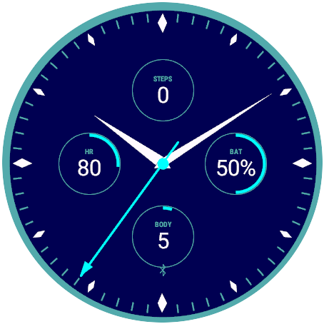
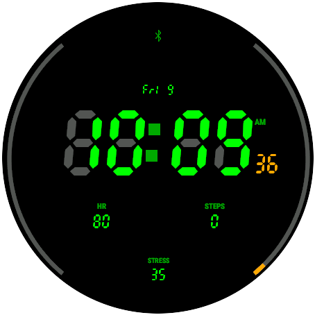
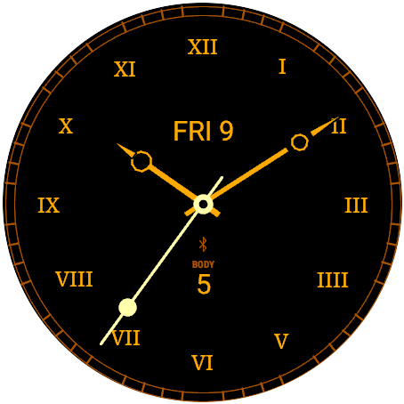
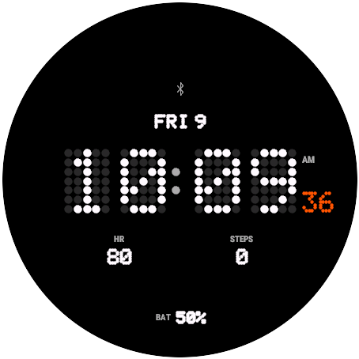

# Open Face

A highly configurable analog and digital watch face for Garmin Connect IQ, for round watches from the
Forerunner 965 generation onward (Forerunner, fēnix, epix, enduro, Venu, vívoactive, MARQ, D2, Descent,
Approach, Instinct AMOLED).

**Docs and gallery:** https://progressive-kiwi.github.io/open-garmin-watchface/
**Download:** [latest release](https://github.com/progressive-kiwi/open-garmin-watchface/releases/latest)

<p align="center">
  
  
  
  
</p>

## Features

| Area | Options |
|---|---|
| Modes | Analog, Digital |
| Layouts | Analog: Classic, Chronograph, Top + bottom, Minimal, Gauges, Pilot · Digital: Classic, Stacked, Big, Sport, Minimal, Side |
| Hands | 9 hour/minute styles, 5 second-hand styles, width, length, outline, per-hand color, center cap |
| Dial | 7 hour-tick and 4 minute-tick styles, tick length, quarter emphasis, Arabic/Roman numerals, dial ring |
| Fonts | System, 6 vector faces, Quartz LCD (filled/outline/thin/upright), dot matrix, pixel blocks, fine dots; unlit-segment effect |
| Data | 4 fields × 22 sources, 2 edge gauges, status icons |
| Colors | 10 themes + custom, 28-color MIP-safe palette, per-element overrides |
| Always-on | AMOLED burn-in-safe low-power face with pixel shift; MIP seconds via partial updates |

Every setting is available in Garmin Connect and on the watch (Watch Face → Customize).
Reference: [docs/settings.qmd](docs/settings.qmd).

## Build

```bash
SDK=$(tools/setup_sdk.sh | tail -n1)
openssl genrsa -out key.pem 4096
openssl pkcs8 -topk8 -inform PEM -outform DER -in key.pem -out developer_key.der -nocrypt
tools/build.sh "$SDK" developer_key.der build all   # build/OpenFace.iq, build/OpenFace-prg.zip
```

Settings are defined once in `tools/gen_settings.py`; see [docs/development.qmd](docs/development.qmd).

## Workflows

| Workflow | Trigger | Output |
|---|---|---|
| CI | push, pull request | generated-file check, strict type check, `.iq` build |
| Release | tag `v*` or manual | GitHub release with `OpenFace.iq` and `OpenFace-prg.zip` |
| Docs | push to `main` | simulator screenshots + Quarto site on GitHub Pages |

Not affiliated with Garmin. Connect IQ is a trademark of Garmin Ltd.
