Rendered by the Connect IQ simulator (Forerunner 970 unless noted) with the clock pinned to 10:09:36.
Simulated sensor values; weather is unavailable in the simulator. The exact settings behind each image
are listed in `VARIANTS` in `tools/screenshots.py`.

## Analog

::: {.grid}

::: {.g-col-12 .g-col-md-6 .g-col-lg-4 .shot}
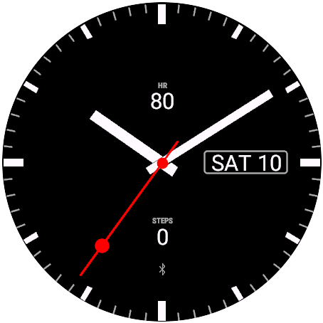{fig-alt="Analog · Classic layout, baton hands, bar ticks, date window"}
:::

::: {.g-col-12 .g-col-md-6 .g-col-lg-4 .shot}
{fig-alt="Analog · Chronograph subdials, dauphine hands, bezel, Ocean theme"}
:::

::: {.g-col-12 .g-col-md-6 .g-col-lg-4 .shot}
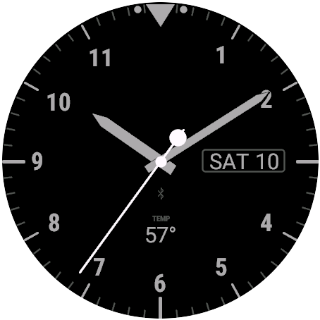{fig-alt="Analog · Pilot layout, sword hands, full numerals"}
:::

::: {.g-col-12 .g-col-md-6 .g-col-lg-4 .shot}
{fig-alt="Analog · Roman numerals, Breguet hands, railway track, Gold theme"}
:::

::: {.g-col-12 .g-col-md-6 .g-col-lg-4 .shot}
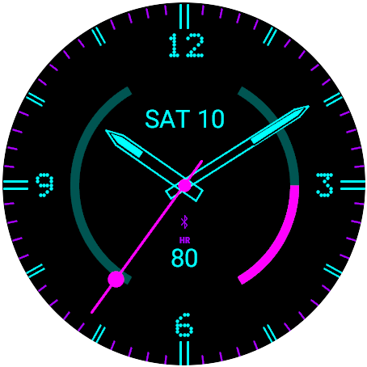{fig-alt="Analog · Gauges layout, skeleton hands, dot-matrix numerals, Neon theme"}
:::

::: {.g-col-12 .g-col-md-6 .g-col-lg-4 .shot}
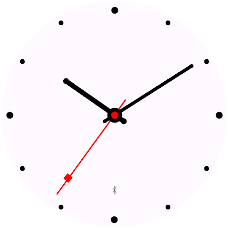{fig-alt="Analog · Minimal layout, rounded hands, dot ticks, Paper theme"}
:::

::: {.g-col-12 .g-col-md-6 .g-col-lg-4 .shot}
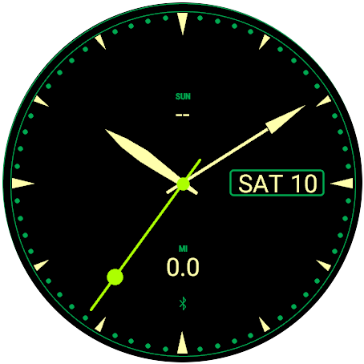{fig-alt="Analog · Arrow and leaf hands, triangle ticks, Forest theme"}
:::

:::

## Digital

::: {.grid}

::: {.g-col-12 .g-col-md-6 .g-col-lg-4 .shot}
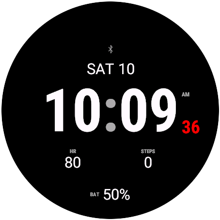{fig-alt="Digital · Classic layout, condensed bold"}
:::

::: {.g-col-12 .g-col-md-6 .g-col-lg-4 .shot}
{fig-alt="Digital · Quartz LCD with unlit segments, Sport layout, gauges"}
:::

::: {.g-col-12 .g-col-md-6 .g-col-lg-4 .shot}
{fig-alt="Digital · Dot matrix, Racing theme"}
:::

::: {.g-col-12 .g-col-md-6 .g-col-lg-4 .shot}
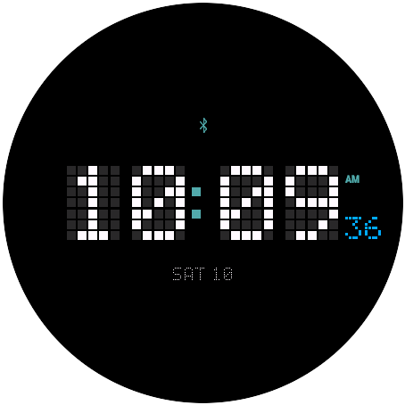{fig-alt="Digital · Pixel blocks, Minimal layout, Ice theme"}
:::

::: {.g-col-12 .g-col-md-6 .g-col-lg-4 .shot}
{fig-alt="Digital · Stacked layout, Roboto black, two-tone"}
:::

::: {.g-col-12 .g-col-md-6 .g-col-lg-4 .shot}
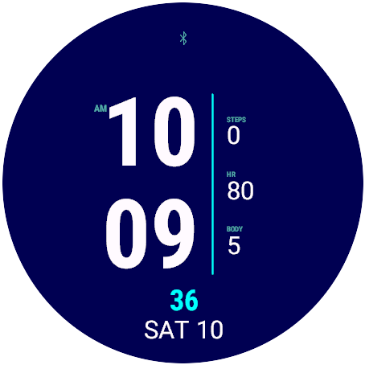{fig-alt="Digital · Side layout, field column, Ocean theme"}
:::

::: {.g-col-12 .g-col-md-6 .g-col-lg-4 .shot}
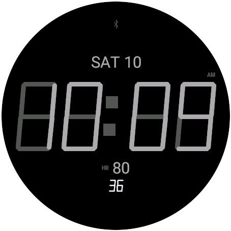{fig-alt="Digital · Big layout, thin quartz, Stealth theme"}
:::

::: {.g-col-12 .g-col-md-6 .g-col-lg-4 .shot}
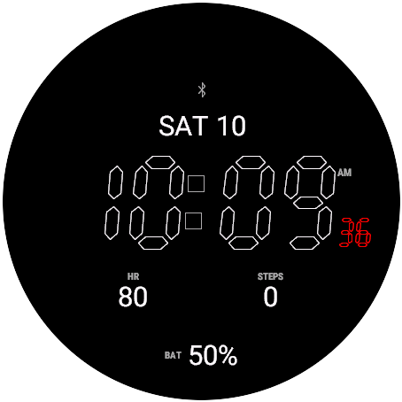{fig-alt="Digital · Quartz outline, Classic theme, seconds"}
:::

::: {.g-col-12 .g-col-md-6 .g-col-lg-4 .shot}
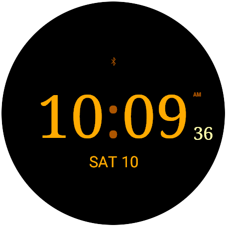{fig-alt="Digital · Serif, Minimal layout, Gold theme"}
:::

:::

## Always-on (AMOLED)

::: {.grid}

::: {.g-col-12 .g-col-md-6 .g-col-lg-4 .shot}
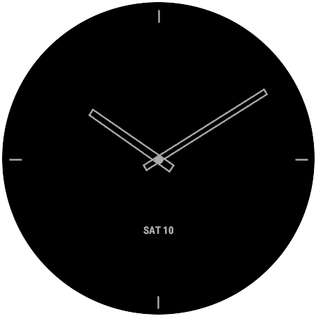{fig-alt="Always-on · Analog, outline hands, quarter markers, date"}
:::

::: {.g-col-12 .g-col-md-6 .g-col-lg-4 .shot}
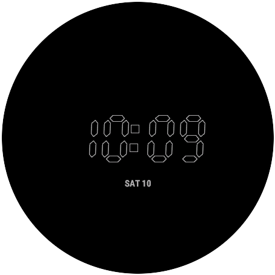{fig-alt="Always-on · Digital, quartz outline"}
:::

:::

## Memory-in-pixel displays

::: {.grid}

::: {.g-col-12 .g-col-md-6 .g-col-lg-4 .shot}
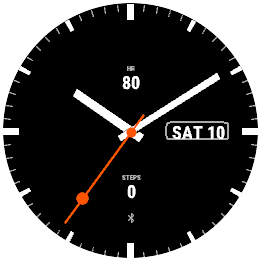{fig-alt="MIP display (fēnix 8 Solar) · Analog classic"}
:::

::: {.g-col-12 .g-col-md-6 .g-col-lg-4 .shot}
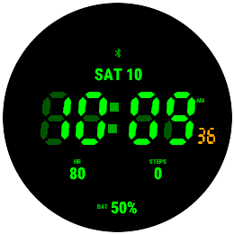{fig-alt="MIP display (fēnix 8 Solar) · Digital quartz"}
:::

::: {.g-col-12 .g-col-md-6 .g-col-lg-4 .shot}
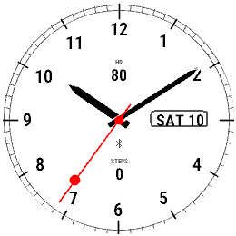{fig-alt="MIP · White background (Paper theme), Arabic numerals, railway track"}
:::

::: {.g-col-12 .g-col-md-6 .g-col-lg-4 .shot}
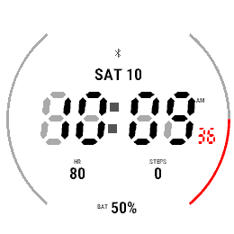{fig-alt="MIP · White background, Quartz LCD with unlit segments"}
:::

::: {.g-col-12 .g-col-md-6 .g-col-lg-4 .shot}
{fig-alt="MIP · Low power, Minimal + date style on white"}
:::

:::
