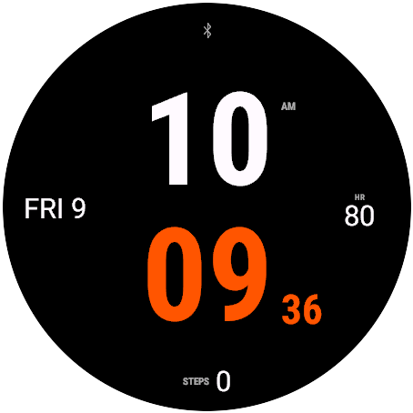

::: {.grid}
::: {.g-col-6 .g-col-md-3 .hero}
{fig-alt="Analog chronograph layout"}
:::
::: {.g-col-6 .g-col-md-3 .hero}
{fig-alt="Digital quartz LCD"}
:::
::: {.g-col-6 .g-col-md-3 .hero}
{fig-alt="Analog Roman numerals"}
:::
::: {.g-col-6 .g-col-md-3 .hero}
{fig-alt="Digital stacked layout"}
:::
:::

Open Face is one watch face with 60+ settings. Analog and digital modes share the data fields, gauges,
color themes and always-on behavior, and every option is available both in the Garmin Connect app and
on the watch itself.

[Download the latest release](https://github.com/progressive-kiwi/open-garmin-watchface/releases/latest){.btn .btn-primary}
[Open the configurator](configurator.qmd){.btn .btn-outline-primary}
[Browse the gallery](gallery.qmd){.btn .btn-outline-secondary}

## Features

| Area | Options |
|---|---|
| Modes | Analog, Digital |
| Analog layouts | Classic (date window), Chronograph (4 subdials), Top + bottom, Minimal, Gauges, Pilot |
| Digital layouts | Classic, Stacked, Big, Sport, Minimal, Side |
| Hands | Baton, Dauphine, Sword, Leaf, Skeleton, Arrow, Needle, Rounded, Breguet; width, length, outline, color per hand |
| Second hand | Needle, Lollipop, Counterweight, Arrow tip, Square tip; off / awake only / always (MIP) |
| Dial | Hour ticks (7 styles), minute ticks (4 styles), tick length, 12/3/6/9 emphasis, numerals (Arabic/Roman, quarters/all/12), dial ring |
| Fonts | System, Condensed bold, Roboto, Roboto black, Bionic, Serif, Condensed italic, **Quartz LCD**, Quartz outline, Quartz thin, Segment upright, **Dot matrix**, Pixel blocks, Dotted fine |
| Font effects | Unlit LCD segments / dots ("ghost"), two-tone hours/minutes, separator style |
| Data | 4 fields from 22 sources (date, battery, steps, heart rate, Body Battery, stress, weather, sunrise/sunset, …), 2 edge gauges, status icons |
| Colors | 10 themes + custom; 28-color MIP-safe palette; per-element overrides |
| Always-on | Style, color, font, outline hands/digits, markers, pixel shift (AMOLED); theme colors on any background (MIP) |
| Night dimming | Fade all colors 10–90 % during Do Not Disturb / sleep mode or the sleep schedule |

## Supported devices

Round Connect IQ watches from the Forerunner 965 generation onward: Forerunner 165/170/255/265/570/955/965/970,
fēnix 7 Pro/8/9/E, epix Pro (Gen 2), enduro 3, Venu 2/3/4, vívoactive 5/6, MARQ (Gen 2), D2 Mach,
Descent Mk3/G2, Approach S50/S70, Instinct 3 AMOLED and Instinct Crossover AMOLED.
See [Install](install.qmd) for the full list.

## Display handling

### AMOLED always-on

While the watch sleeps, AMOLED models show a separate low-pixel face that stays within Garmin's burn-in
rules (≤ 10 % lit pixels, no pixel lit for more than 3 minutes). Settings, group **Always-on**:

| Setting | Effect |
|---|---|
| AOD style | *Auto* / *Full face* → minimal face with date (a full face is never shown on AMOLED); *Minimal*; *Minimal + date*; *Time only* |
| AOD color | Single color for everything drawn while asleep; default light gray |
| AOD font | Digital mode: *Same as time* or any font family |
| Outline hands / digits | Hollow hands; filled Quartz and dot fonts switch to their outline / fine-dot variants |
| AOD markers | None, 12/3/6/9 bars, or 12 hour dots |
| Pixel shift | Moves the face by up to ±r/60 px every minute in a 9-step cycle |

### MIP (memory-in-pixel)

Lit pixels cost no power on MIP screens, so the full face stays visible in low power, in the theme colors.
White and other light backgrounds work in every mode: the *Paper* theme, or *Custom* with a light
background. Unlit segment/dot color and gauge tracks default to *Auto*, a step from the background
toward the primary color, so they stay subtle on both dark and light backgrounds.

- *AOD style* also applies: *Minimal*, *Minimal + date* and *Time only* use the theme background and
  primary color, with filled hands. *AOD color*, *Outline* and *Pixel shift* are AMOLED-only.
- *Seconds → Always (MIP)* keeps the second hand or seconds digits running every second in low power,
  through partial updates from an off-screen buffer.

### Night dimming

Fades every color by a set percentage toward the background (on AMOLED always-on, the AOD color toward
black). Settings, group **Night**:

| Setting | Options |
|---|---|
| Night dimming | Off · Do Not Disturb / sleep mode · Sleep schedule · Either |
| Fade amount | 10–90 % |

Connect IQ does not expose Garmin focus modes to watch faces. The Sleep focus turns on Do Not Disturb,
which the face reads (`DeviceSettings.doNotDisturb`); *Sleep schedule* uses the bedtime and wake time from
the user profile (`UserProfile`).
